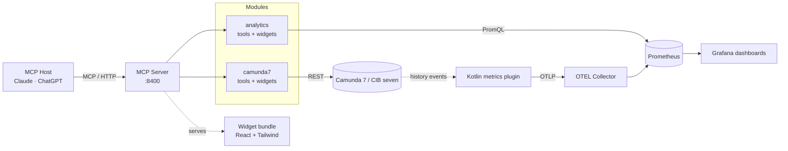

# Pulse architecture

Pulse is a single Node.js MCP server that exposes Camunda 7 / CIB seven
operations and Prometheus-backed analytics to any MCP host (Claude, ChatGPT, …). A Kotlin plugin
in the engine emits process metrics via Micrometer, pushed over OTLP; the OTEL Collector exports
them to Prometheus so the analytics module can query them.

## At a glance

## Modules

| Module                                                               | Role                                                                                                                                                                                                                        |
| -------------------------------------------------------------------- | --------------------------------------------------------------------------------------------------------------------------------------------------------------------------------------------------------------------------- |
| **MCP Server** (`apps/mcp-server-camunda7/`)                         | Hosts the HTTP transport on port `8400`, loads modules from `MCP_ACTIVE_MODULES`, and serves the Vite-built React widget bundle (see **widgets**).                                                                          |
| **camunda7** (`packages/connectors/camunda/camunda7-connector/`)     | Wraps the Camunda 7 / CIB seven REST API via an OpenAPI-generated client. Exposes process, task, incident, deployment, and history tools plus widgets.                                                                      |
| **analytics** (`packages/connectors/analytics/analytics-connector/`) | Queries Prometheus via PromQL for performance, failure, bottleneck, version/cluster comparison, and the cross-engine landscape. Tools + widgets.                                                                            |
| **engine-plugins** (`engine-plugins/`)                               | Kotlin Micrometer plugins for CIB seven: a process-metrics emitter. Independent build (Java 21, Gradle). No engine-side database.                                                                                           |
| **widgets** (`apps/mcp-server-camunda7/dist/mcp-app.js` + `.css`)    | One Vite-built ES module + stylesheet containing React, Tailwind, and every widget. mcp-use serves it behind one `ui://views/<tool>.html` resource per widget tool, which declares that view on itself (`showToolBinding`). |

## Composition rules

A small set of layering rules keeps modules independently usable and a future
second engine dialect cheap:

- App = one product per engine dialect. `apps/mcp-server-camunda7` is the
  thin composition root of the Camunda-7-dialect product (camunda7 +
  analytics). Engine _vendors_ of that dialect (CIB seven, Operaton, Camunda 7)
  are per-engine runtime configuration (`flavor` on the engine entry, resolved
  to an `EngineProvider` carrying only the real differences: cockpit routes,
  branding, client hook), never separate apps. A different dialect (e.g.
  Flowable, with its own REST API) would be its own module, client, and app.
- Modules are peers. Connector packages (`*-connector`) never import each other. Cross-module
  capabilities are injected by the app, e.g. the camunda7 module's BPMN-XML lookup feeding the
  analytics heatmap and the names in its views (`SharedResources.fetchBpmnXml`) and its
  configured engine ids, the only engines analytics reads (`engineIds`).
- Modules are self-contained. Each exports a module definition: config schema, env mapping,
  known env vars, toolset vocabulary, boot warnings, plugin factory
  (`packages/connectors/<family>/<name>-connector/src/module.ts`). The app only selects modules
  (`MCP_ACTIVE_MODULES`) and wires shared resources against its own port
  (`apps/mcp-server-camunda7/src/module-contract.ts`); the shared composition resolves one
  fail-closed toolset per module per boot (read-only unless widened) and logs it. The module
  packages are published to npm, so external composition roots can mount them next to their own
  modules. The reference is `templates/composed-server/`.
- Apps own no domain UI. Widgets and their catalogues live in packages:
  `widget-shell` carries the generic primitives plus the `shell:*` widgets;
  each module carries its own. Cross-module UI has three sanctioned tiers:
  generic `shell:*` widgets fed via `props.dataKey`, tool-name string
  references with graceful degradation, and hard-composed views in a dedicated
  package (created with the first real view).
- Extract on the second consumer, never speculatively. A composed-views
  package appears with the first cross-module view, a shared domain-widget
  package with a second dialect, a host-kit with a second app.

## User settings

Preferences live in one profile record per user, shared by every module and
persisted in Postgres (`DATABASE_URL`), on disk (`MCP_PROFILE_DIR`), or in
memory, in that order of precedence. The record is keyed by the signed-in user:
`MCP_OAUTH` is the only caller identity, so without it settings show their
defaults and cannot be saved.

| Part                     | Owner        | Contents                                                                   |
| ------------------------ | ------------ | -------------------------------------------------------------------------- |
| Core record + store      | widget-shell | Language and its `shell_*` tools, record metadata, slice transport, stores |
| `modules.<module>` slice | that module  | Whatever only it understands, e.g. camunda7's engine picks                 |

Each module owns its slice end to end: its own schema, its own save tool, and
its own section on the settings page. Nothing central knows what a slice
contains. The record only transports it, and a save merges per module key
over the raw stored record, one save per user at a time, so one module can
never overwrite another's settings and fields a newer server version wrote
survive. Reads are fail-soft throughout: an unreadable value or an unreachable
store yields defaults rather than an error (the saved default engine included),
so a profile-store hiccup can't break a call that only needs the engine or
Prometheus. Navigating the cockpit never changes the default engine; only the
settings page or `camunda7_select_engine` does.

The settings page belongs to the shell (`shell_show_settings`, and the
cockpit's settings tab): the language section first, then one section widget
per module, assembled from the widgets the server actually bundles: every
widget id ending in `:settings` becomes a row. A module that isn't mounted
has no section, and a custom module in a composed server contributes
its section by that convention alone. The language save is a framework write,
like the dashboard builder: it needs `MCP_OAUTH` and no module on read-only.

## External systems

| System                  | Purpose                                                                        | Default endpoint                    |
| ----------------------- | ------------------------------------------------------------------------------ | ----------------------------------- |
| Camunda 7 / CIB seven   | The BPM engine itself: process definitions, instances, tasks, incidents.       | `http://localhost:8410/engine-rest` |
| OpenTelemetry collector | Receives OTLP from the engine; exports metrics to Prometheus.                  | `:8431` (OTLP HTTP)                 |
| Prometheus              | Time-series store for the process metrics; the analytics module's data source. | `http://localhost:8460`             |
| Grafana                 | Provisioned process-analytics dashboards over Prometheus.                      | `http://localhost:8470`             |

## Data flow

1. The MCP host calls a tool on the server (e.g. `analytics_element_bottleneck`).
2. The server delegates to the matching module's plugin.
3. The plugin calls the relevant system (REST for the engine, PromQL for
   Prometheus) and returns JSON for the model.
4. A widget tool (`show_*`) returns a short summary for the model plus a
   `structuredContent` layout; the host renders it in the view the tool
   declares, from the shared bundle. Inside the view, app-only `*_data` feeds
   refresh and page it without a model turn.

Process metrics originate in the engine: the Kotlin plugin maps history events
to Micrometer counters/histograms (100 % coverage, model-bounded labels), the
Collector receives them over OTLP, and Prometheus stores them. Per-instance drill-down (search) is
served by the engine REST history API, not the metrics.

## Repository layout

| Path                        | Description                                             |
| --------------------------- | ------------------------------------------------------- |
| `apps/mcp-server-camunda7/` | The MCP server entry point and the widget bundle.       |
| `packages/`                 | Reusable libraries: clients, MCP plugins, widget-shell. |
| `engine-plugins/`           | Kotlin Micrometer plugins (process metrics).            |
| `playground/`               | Demo env: showcases, Compose stack, Fly.io deployment.  |

For deeper detail, the root [`README.md`](https://github.com/Miragon/pulse/blob/main/README.md) keeps the full module table and tool list.
